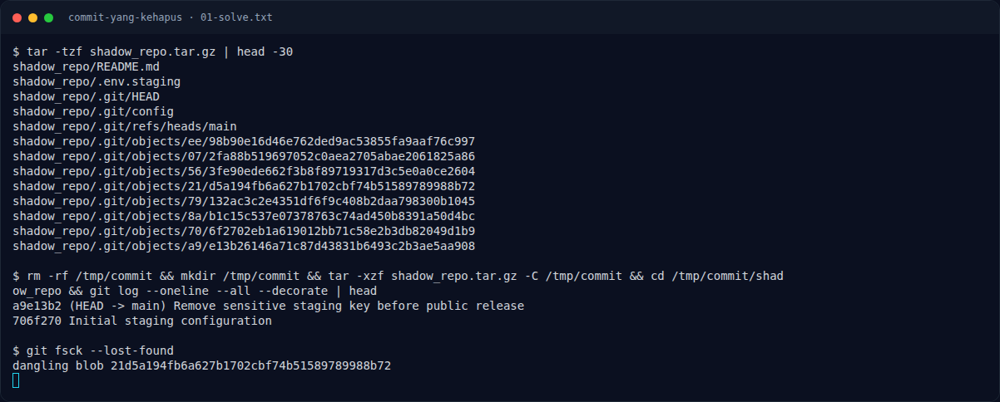
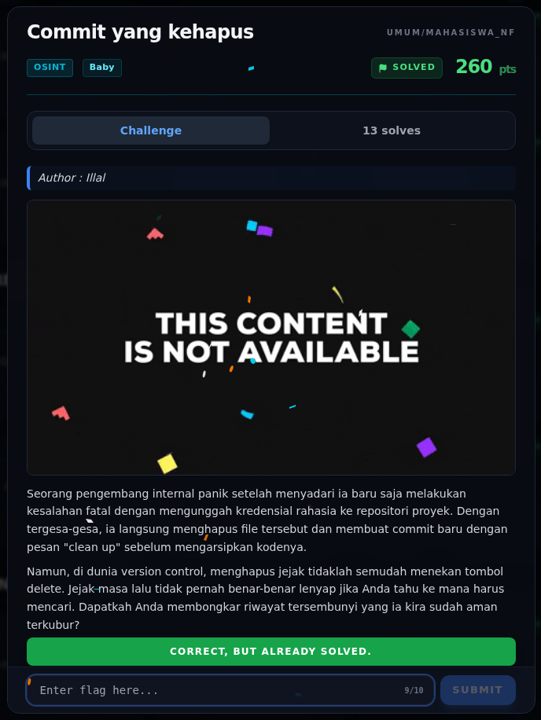

# Commit yang kehapus — Flag & Verifikasi

[← Overview](84-commit-yang-kehapus.md) · [Index](index.md)

> **Langkah 3/5 — Flag.** Flag
>
> **Titik penting:** NFXCTF{g1t_d4ngl1ng_bl0b_h4v0c_5c8a19d4}
>
> **Berikutnya:** [Bukti / Evidence](84-commit-yang-kehapus-04-bukti-evidence.md)

> **Asal flag.** Flag diperoleh dari langkah exploit/solver yang terdokumentasi, lalu disubmit ke platform.  

> **Flag:** `NFXCTF{g1t_d4ngl1ng_bl0b_h4v0c_5c8a19d4}`
> **Status:** `VERIFIED`

```text
NFXCTF{g1t_d4ngl1ng_bl0b_h4v0c_5c8a19d4}
```

### Terminal evidence (real)



*Terminal evidence (real).*

> **Bukti:** terminal evidence (real).

## Validasi platform (real)



*Screenshot asli dari platform NFX CTF 2026. Platform menjawab
`CORRECT, BUT ALREADY SOLVED.` untuk flag ini.*
