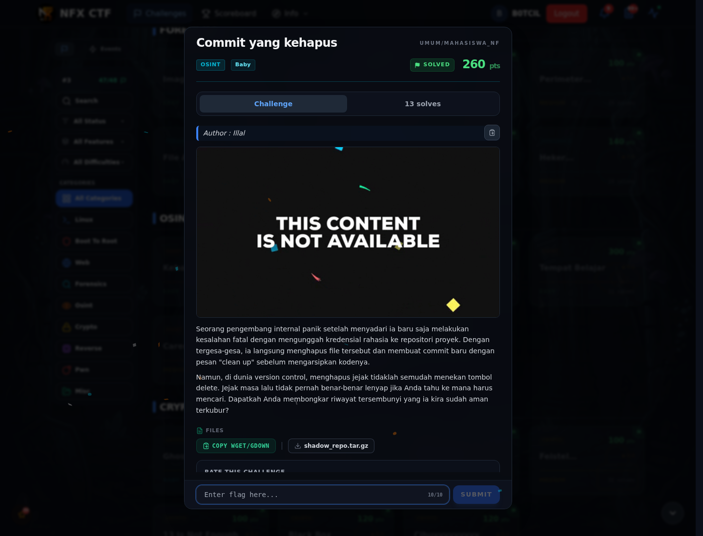

# Commit yang kehapus — Referensi

[← Overview](84-commit-yang-kehapus.md) · [Index](index.md)

> **Langkah 5/5 — Referensi.** Git dangling object, deleted commit.
>
> **Titik penting:** Git dangling object, deleted commit.
>
> **Selesai.** Kembali ke [Overview](84-commit-yang-kehapus.md).

Git dangling object, deleted commit.

### Evidence langkah ini

*Challenge brief asli di platform NFX CTF 2026.*
