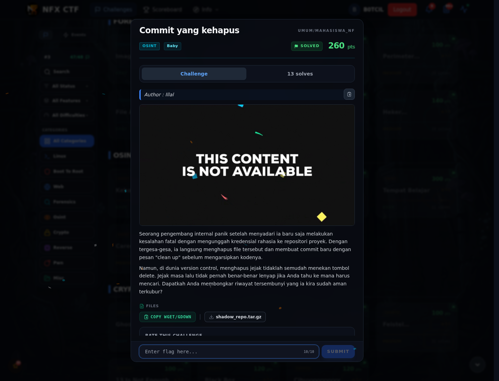
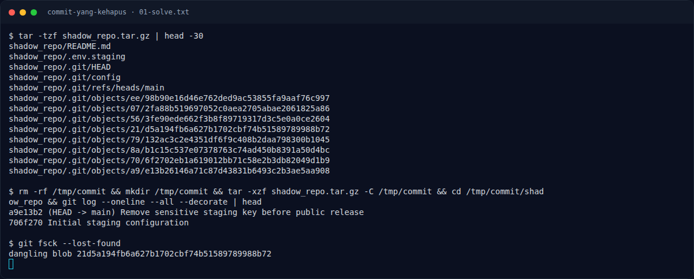

# Commit yang kehapus

Track Mahasiswa NF · OsintBaby260 poinVERIFIED

| Field | Nilai |
|---|---|
| Event | `umum/mahasiswa_nf` |
| Kategori | `Osint` |
| Difficulty | `Baby` |
| Poin | `260` |
| Tools | git |
| Flag | `NFXCTF{g1t_d4ngl1ng_bl0b_h4v0c_5c8a19d4}` |
| Status | `VERIFIED` |

[← Kembali ke Index](index.md)

## Challenge Brief (platform)

*Challenge brief asli di platform NFX CTF 2026.*

## Alur & Titik Penting

| # | Langkah | Titik penting | Buka |
|---:|---|---|---|
| 1 | Jejak Awal | Baca brief challenge dan cek attachment/service yang diberikan. | [Buka](84-commit-yang-kehapus-01-jejak-awal.md) |
| 2 | Cara Mendapatkan Flag | NFXCTF{g1t_d4ngl1ng_bl0b_h4v0c_5c8a19d4} | [Buka](84-commit-yang-kehapus-02-cara-mendapatkan-flag.md) |
| 3 | Flag | NFXCTF{g1t_d4ngl1ng_bl0b_h4v0c_5c8a19d4} | [Buka](84-commit-yang-kehapus-03-flag.md) |
| 4 | Bukti / Evidence | arsip screenshot dan transkrip | [Buka](84-commit-yang-kehapus-04-bukti-evidence.md) |
| 5 | Referensi | Git dangling object, deleted commit. | [Buka](84-commit-yang-kehapus-05-referensi.md) |

## Cerita singkat

Ada repo publik dengan commit yang dihapus. Object dangling masih bisa ditemukan lewat `git fsck`, lalu isinya didekripsi.

Pratinjau evidence. Buka halaman <a href="84-commit-yang-kehapus-04-bukti-evidence.html">Evidence / Bukti</a> untuk semua screenshot dan transkrip.

## Navigasi Halaman

<a class="nx-page-card" href="84-commit-yang-kehapus-01-jejak-awal.html"><b>Jejak Awal</b>Baca bagian ini</a>
<a class="nx-page-card" href="84-commit-yang-kehapus-02-cara-mendapatkan-flag.html"><b>Cara Mendapatkan Flag</b>Flag dan verifikasi platform</a>
<a class="nx-page-card" href="84-commit-yang-kehapus-03-flag.html"><b>Flag</b>Flag dan verifikasi platform</a>
<a class="nx-page-card" href="84-commit-yang-kehapus-04-bukti-evidence.html"><b>Bukti / Evidence</b>Screenshot, transkrip, dan artefak</a>
<a class="nx-page-card" href="84-commit-yang-kehapus-05-referensi.html"><b>Referensi</b>Sumber dan bacaan lanjutan</a>

