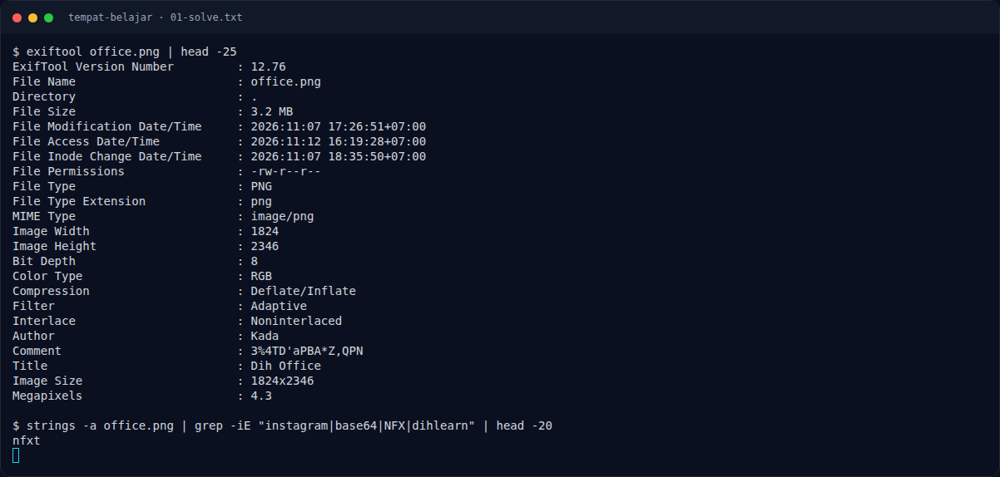

# Tempat Belajar — Jejak Awal

[← Overview](85-tempat-belajar.md) · [Index](index.md)

> **Langkah 1/5 — Jejak Awal.** Poster `office.png` membocorkan nama Dih dan komentar yang bukan flag.
>
> **Titik penting:** Author `Kada`, Title `Dih Office`, Comment `3%4TD'aPBA*Z,QPN`.
>
> **Berikutnya:** [Cara Mendapatkan Flag](85-tempat-belajar-02-cara-mendapatkan-flag.md)

```bash
exiftool -Author -Title -Comment office.png
```

```text
Author  : Kada
Title   : Dih Office
Comment : 3%4TD'aPBA*Z,QPN
```

Nama “Dih” mengarah ke Instagram `@dihlearn.id`. Komentar di metadata adalah
decoy/password, bukan flag.

### Evidence langkah ini



*Terminal evidence — `01-solve.txt` (arsip transkrip sesi solve).*

**Berkas mentah langkah ini:**

- [`01-solve.txt`](assets/tempat-belajar/01-solve.txt)
