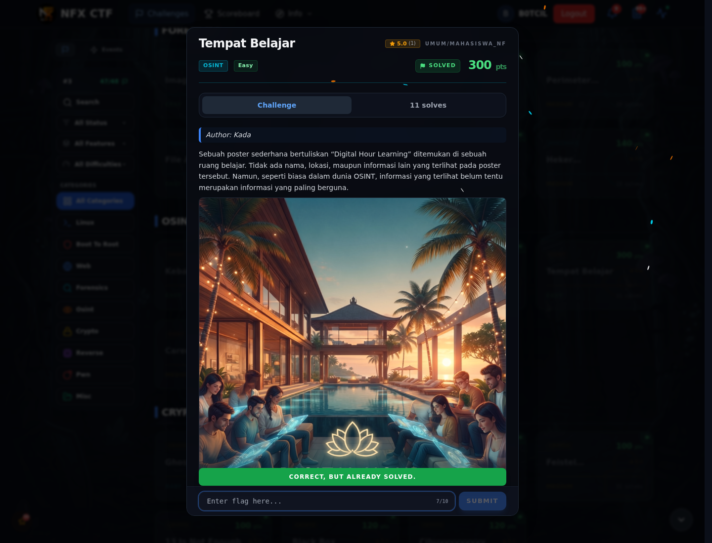

# Tempat Belajar — Cara Mendapatkan Flag

[← Overview](85-tempat-belajar.md) · [Index](index.md)

> **Langkah 2/5 — Cara Mendapatkan Flag.**
>
> **Flag final:** `NFX{Op3n_S0urc3_Pl4tF0m_D1hL3rn_J4Ya}`
> **Status:** `VERIFIED`

## 1. Metadata poster

```bash
exiftool -a -u -g1 office.png
```

```text
Author  : Kada
Title   : Dih Office
Comment : 3%4TD'aPBA*Z,QPN
```

`Comment` adalah decoy/password, bukan flag. Dari `Title: Dih Office`, kita
mendapat petunjuk nama **Dihlearn**.

## 2. Instagram

Akun yang terkait:

- `@dihlearn.id` — poster “Digital Hour Learning”.
- `@career.dihlearn.id` — akun karier.

Di Instagram `@dihlearn.id` ada teks **Base64**. Teks itu didekode menjadi:

```text
NFX{Op3n_S0urc3_Pl4tF0m_D1hL3rn_J4Ya}
```

Kandidat dari post karier yang berakhiran `J4R!` adalah artefak lama dan
**ditolak** platform. Yang benar memakai `J4Ya`.

## 3. Submit ke platform

Flag di-submit lewat form web platform dan diterima:

```text
NFX{Op3n_S0urc3_Pl4tF0m_D1hL3rn_J4Ya}
CORRECT, BUT ALREADY SOLVED.
```

Screenshot submit:



*Form challenge menampilkan `CORRECT, BUT ALREADY SOLVED.`*
