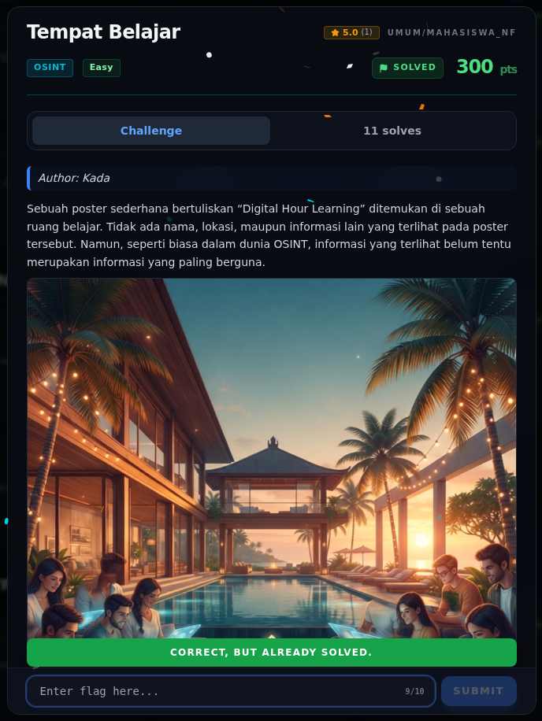

# Tempat Belajar — Flag

[← Overview](85-tempat-belajar.md) · [Index](index.md)

> **Langkah 3/5 — Flag.**
>
> **Status:** `VERIFIED`
> **Asal flag.** Flag dari teks Base64 Instagram `@dihlearn.id` + screenshot submit web.  
> **Tingkat bukti metode.** Terdokumentasi. [Buka Evidence](85-tempat-belajar-04-bukti-evidence.md)

> **Status metode:** **PARTIAL** — Flag accepted; provenance teks J4Ya dari artefak Instagram/DM belum ditunjukkan penuh.  
> **Flag:** `NFX{Op3n_S0urc3_Pl4tF0m_D1hL3rn_J4Ya}`

## Flag

```text
NFX{Op3n_S0urc3_Pl4tF0m_D1hL3rn_J4Ya}
```

## Catatan

Kandidat lama `NFX{Op3n_S0urc3_Pl4tF0m_D1hL3rn_J4R!}` ditolak. Flag yang benar
berakhir `J4Ya` dan berasal dari teks Base64 di Instagram `@dihlearn.id`.

## Validasi platform (real)



*Screenshot asli dari platform NFX CTF 2026. Platform menjawab
`CORRECT, BUT ALREADY SOLVED.` untuk flag ini.*
