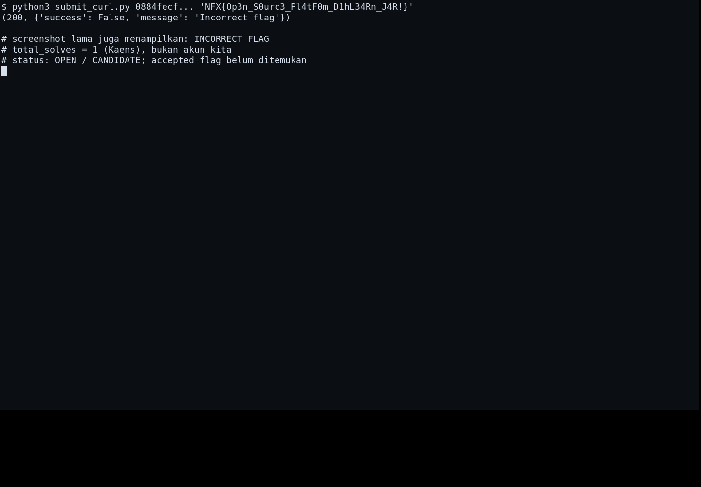

# Tempat Belajar — Flag

[← Overview](85-tempat-belajar.md) · [Index](index.md)

> **Langkah 3/5 — Flag.**
>
> **Status:** `OPEN / CANDIDATE`
> **Kandidat:** `NFX{Op3n_S0urc3_Pl4tF0m_D1hL3rn_J4R!}`

## Kandidat artefak (DITOLAK)

```text
NFX{Op3n_S0urc3_Pl4tF0m_D1hL3rn_J4R!}
```

Ini adalah hasil decode base64 dari dua post `@career.dihlearn.id`.
Platform menolaknya, termasuk varian corrected `Pl4tF0rm`, `D1hL34rn`,
`S0urc1`.

## Status

- `total_solves` challenge = **1** (Kaens), bukan akun kita.
- Terminal evidence menampilkan API response **`Incorrect flag`**.
- Flag accepted belum ditemukan; kemungkinan ada di DM `@dihlearn.id`.
- Jangan menandai halaman ini `VERIFIED` sampai ada submit sukses asli.

## Bukti kegagalan



*Terminal evidence: API response `Incorrect flag` untuk kandidat `D1hL34Rn`.*
