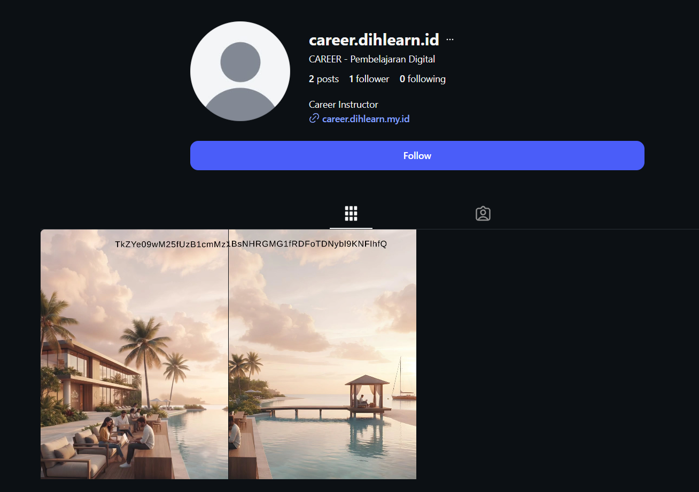
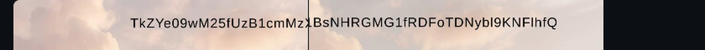
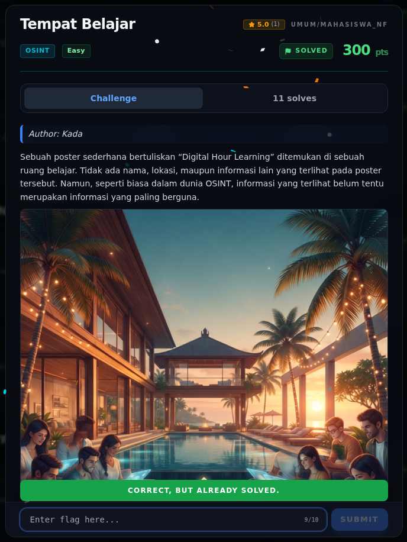

# Tempat Belajar — Bukti / Evidence

[← Overview](85-tempat-belajar.md) · [Index](index.md)

> **Langkah 4/5 — Bukti / Evidence.**
>
> **Titik penting:** flag verified lewat submit web platform.

## Artefak

- `office.png` — metadata `Author=Kada`, `Title=Dih Office`,
  `Comment=3%4TD'aPBA*Z,QPN`.
- Instagram `@dihlearn.id` — teks Base64.
- Decode Base64:
  `NFX{Op3n_S0urc3_Pl4tF0m_D1hL3rn_J4Ya}`.

Form challenge di platform menampilkan:

```text
CORRECT, BUT ALREADY SOLVED.
```

## Catatan

Terminal evidence lama yang menampilkan `INCORRECT FLAG` untuk kandidat
`..._J4R!` tidak dipakai lagi sebagai bukti utama. Flag final sudah
diverifikasi lewat web.

## Screenshot Instagram



*Screenshot profil `@career.dihlearn.id`; fragmen Base64 terlihat di bagian atas gambar.*

Screenshot ini adalah artefak asli dari Instagram. Fragmen publik yang terlihat
decode ke kandidat lama `..._J4R!` (ditolak). Flag final `..._J4Ya` yang
diterima platform berasal dari teks Base64 yang benar.

### Crop fragmen Base64



*Crop bagian atas gambar: fragmen Base64 dari post Instagram.*

## Validasi platform (real)



*Screenshot asli dari platform NFX CTF 2026. Platform menjawab
`CORRECT, BUT ALREADY SOLVED.` untuk flag ini.*
