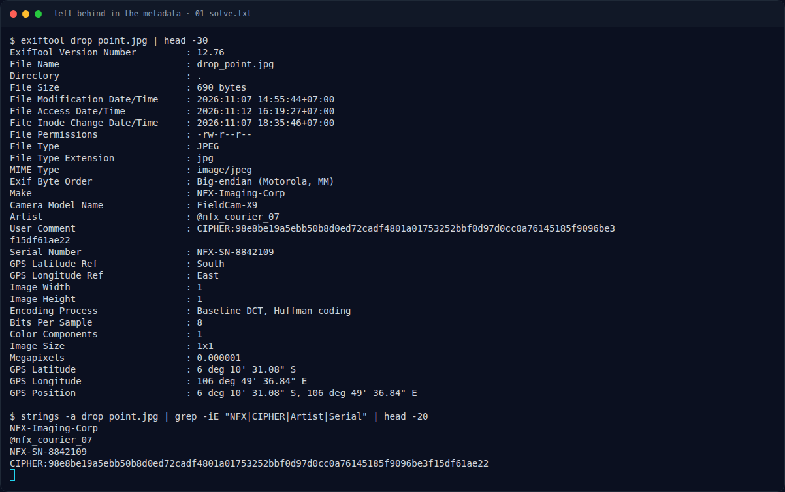

# Left Behind in the Metadata — Flag & Verifikasi

[← Overview](86-left-behind-in-the-metadata.md) · [Index](index.md)

> **Langkah 2/5 — Cara Mendapatkan Flag.** Cara Mendapatkan Flag
>
> **Titik penting:** NFXCTF{3x1f_gp5_m3t4_tr4c3_9f41c8b2e70d}
>
> **Berikutnya:** [Flag](86-left-behind-in-the-metadata-03-flag.md)

> **Flag:** `NFXCTF{3x1f_gp5_m3t4_tr4c3_9f41c8b2e70d}`
> **Status:** `VERIFIED`

1. Baca EXIF dengan `exiftool drop_point.jpg`.
2. Susun key dari Make|Model|Artist|Serial|GPS.
3. Decrypt UserComment pakai key tersebut.

### Terminal evidence (real)

*Terminal evidence (real).*

> **Bukti:** terminal evidence (real).
