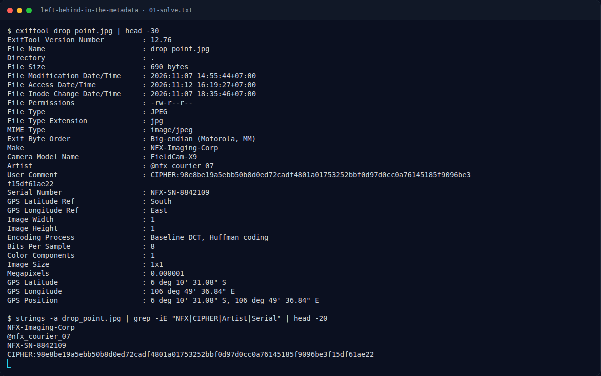

# Left Behind in the Metadata — Flag & Verifikasi

[← Overview](86-left-behind-in-the-metadata.md) · [Index](index.md)

> **Langkah 3/5 — Flag.** Flag
>
> **Titik penting:** NFXCTF{3x1f_gp5_m3t4_tr4c3_9f41c8b2e70d}
>
> **Berikutnya:** [Bukti / Evidence](86-left-behind-in-the-metadata-04-bukti-evidence.md)

> **Flag:** `NFXCTF{3x1f_gp5_m3t4_tr4c3_9f41c8b2e70d}`
> **Status:** `VERIFIED`

```text
NFXCTF{3x1f_gp5_m3t4_tr4c3_9f41c8b2e70d}
```

### Terminal evidence (real)



*Terminal evidence (real).*

> **Bukti:** terminal evidence (real).
