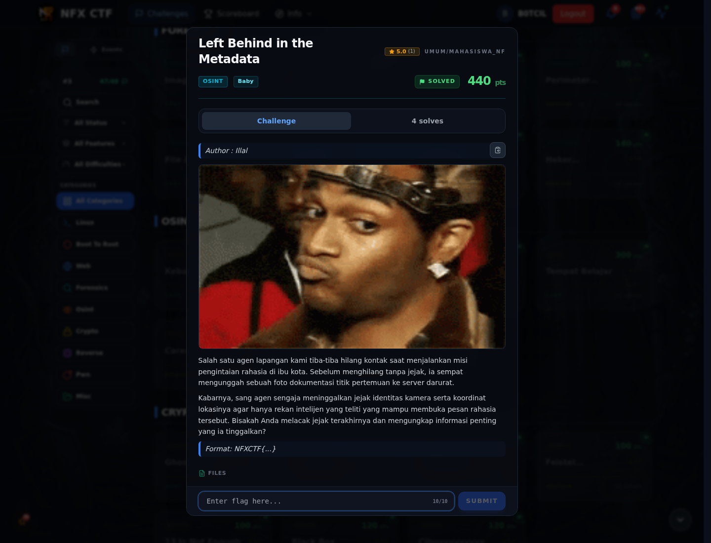

# Left Behind in the Metadata — Referensi

[← Overview](86-left-behind-in-the-metadata.md) · [Index](index.md)

> **Langkah 5/5 — Referensi.** EXIF metadata, GPS, custom SHA256 stream cipher.
>
> **Titik penting:** EXIF metadata, GPS, custom SHA256 stream cipher.
>
> **Selesai.** Kembali ke [Overview](86-left-behind-in-the-metadata.md).

EXIF metadata, GPS, custom SHA256 stream cipher.

### Evidence langkah ini

*Challenge brief asli di platform NFX CTF 2026.*
