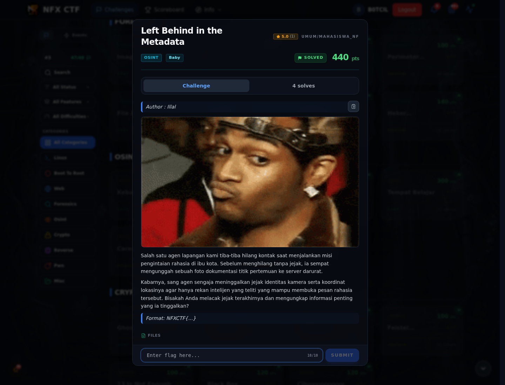
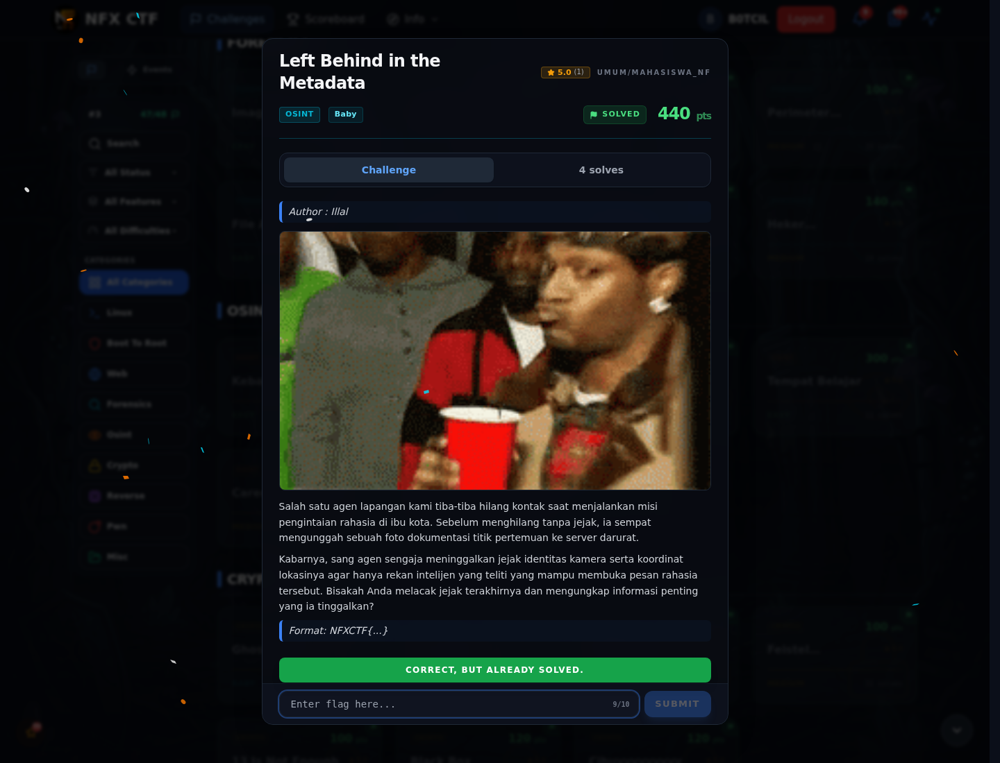

# Left Behind in the Metadata

Track Mahasiswa NF · OsintBaby440 poinVERIFIED

| Field | Nilai |
|---|---|
| Event | `umum/mahasiswa_nf` |
| Kategori | `Osint` |
| Difficulty | `Baby` |
| Poin | `440` |
| Tools | exiftool |
| Flag | `NFXCTF{3x1f_gp5_m3t4_tr4c3_9f41c8b2e70d}` |
| Status | `VERIFIED` |

[← Kembali ke Index](index.md)

## Challenge Brief (platform)

*Challenge brief asli di platform NFX CTF 2026.*

## Alur & Titik Penting

| # | Langkah | Titik penting | Buka |
|---:|---|---|---|
| 1 | Jejak Awal | Baca brief challenge dan cek attachment/service yang diberikan. | [Buka](86-left-behind-in-the-metadata-01-jejak-awal.md) |
| 2 | Cara Mendapatkan Flag | NFXCTF{3x1f_gp5_m3t4_tr4c3_9f41c8b2e70d} | [Buka](86-left-behind-in-the-metadata-02-cara-mendapatkan-flag.md) |
| 3 | Flag | NFXCTF{3x1f_gp5_m3t4_tr4c3_9f41c8b2e70d} | [Buka](86-left-behind-in-the-metadata-03-flag.md) |
| 4 | Bukti / Evidence | arsip screenshot dan transkrip | [Buka](86-left-behind-in-the-metadata-04-bukti-evidence.md) |
| 5 | Referensi | EXIF metadata, GPS, custom SHA256 stream cipher. | [Buka](86-left-behind-in-the-metadata-05-referensi.md) |

## Cerita singkat

Foto `drop_point.jpg` menyimpan EXIF lengkap: kamera, artis, serial, GPS, dan cipher. EXIF itu jadi key untuk mendekripsi pesan.

Pratinjau evidence. Buka halaman <a href="86-left-behind-in-the-metadata-04-bukti-evidence.html">Evidence / Bukti</a> untuk semua screenshot dan transkrip.

## Navigasi Halaman

<a class="nx-page-card" href="86-left-behind-in-the-metadata-01-jejak-awal.html"><b>Jejak Awal</b>Baca bagian ini</a>
<a class="nx-page-card" href="86-left-behind-in-the-metadata-02-cara-mendapatkan-flag.html"><b>Cara Mendapatkan Flag</b>Flag dan verifikasi platform</a>
<a class="nx-page-card" href="86-left-behind-in-the-metadata-03-flag.html"><b>Flag</b>Flag dan verifikasi platform</a>
<a class="nx-page-card" href="86-left-behind-in-the-metadata-04-bukti-evidence.html"><b>Bukti / Evidence</b>Screenshot, transkrip, dan artefak</a>
<a class="nx-page-card" href="86-left-behind-in-the-metadata-05-referensi.html"><b>Referensi</b>Sumber dan bacaan lanjutan</a>

